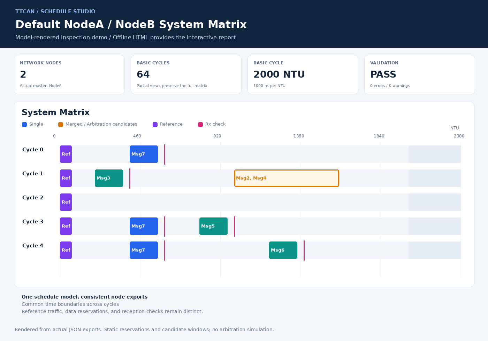
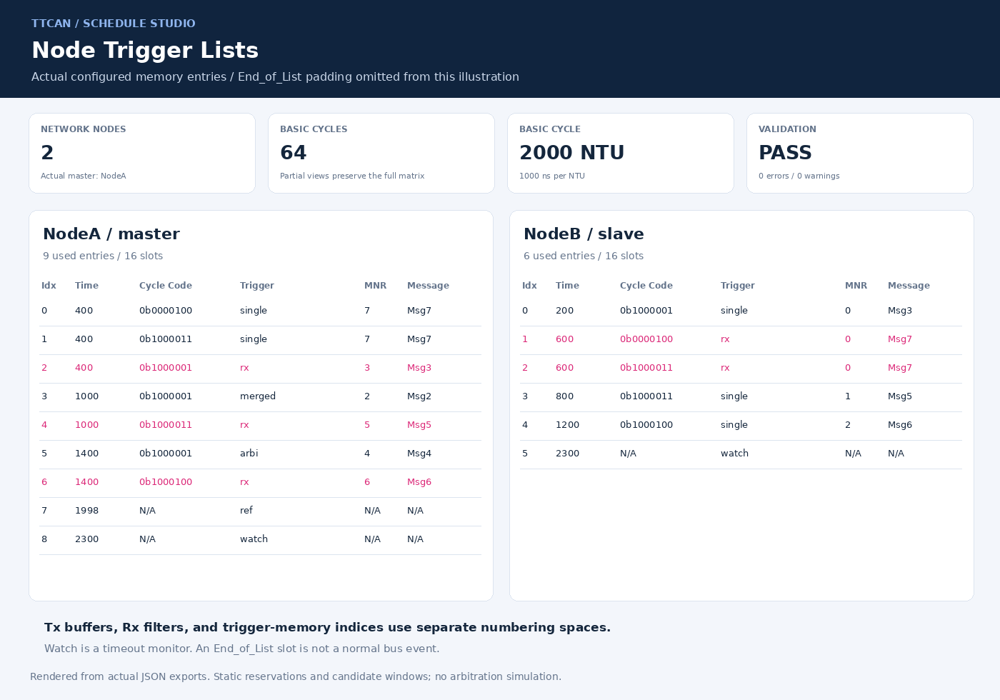
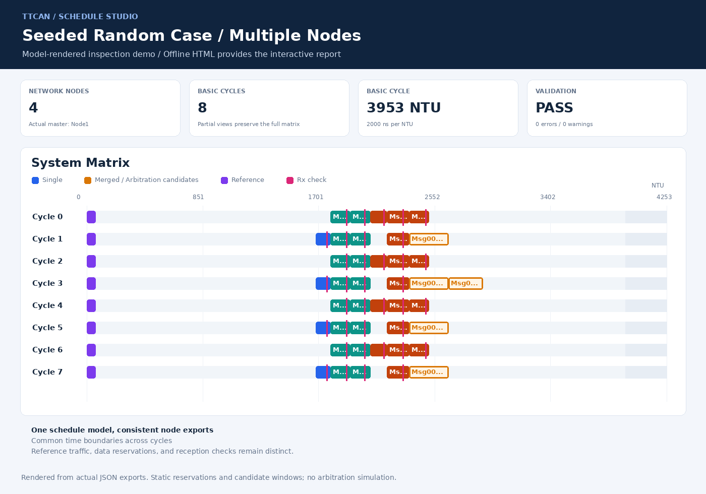

# TTCAN Schedule Studio

**Generate TTCAN system matrices, node trigger lists, and reproducible random test configurations with Python.**

TTCAN Schedule Studio is a static scheduling and visualization tool for Classical CAN / TTCAN. Define nodes, message resources, timing constraints, and transmission opportunities in JSON, then generate a consistent global schedule and per-node views.

A companion constrained random generator produces replayable test configurations. Every accepted random case includes validation results and its own self-contained HTML report.

> This is an independent planning and verification aid, not a Bosch product or a protocol conformance certification tool. It uses a static Level 1 reservation model, does not simulate actual arbitration outcomes, and does not export a hardware register image.

## Demo


The animation is rendered from the actual exported JSON. It illustrates schedule inspection, not simulated bus traffic or a browser recording. Download the project and open `output/schedule.html` for the interactive HTML interface.

<details>
<summary>System matrix, node trigger lists, and random-case previews</summary>

### Default system matrix



### Node trigger lists



### Random case



</details>

## Features

- Global timeline and system matrix derived from one scheduling model.
- Per-node Tx buffer and standard/extended Rx filter mappings.
- Per-node trigger lists with cycle conditions and resource references.
- Single, Arbitration, and Merged transmission scheduling.
- Supported Single-message reception checks with conservative completion bounds and last-filter validation.
- Reference and Watch configuration, with timeout monitors distinguished from normal bus activity.
- Fixed-position and deterministic automatic placement.
- Configurable capacities and explicit or automatic resource numbering.
- Offline HTML with filtering, time scaling, hover details, and linked node views.
- Seed-reproducible random generation, bounded retries, feature requirements, and batch summaries.
- CSV/JSON exports for inspection and verification workflows.

## Requirements

- **Python 3.10+**.
- A modern browser to view generated reports.
- No third-party Python packages for scheduling, generation, or unit tests.

Keep `ttcan_scheduler.py` and `assets/report_template.html` in their repository locations when generating reports. A generated `schedule.html` can be copied and opened independently, without a server or internet connection.

Optional browser tests require Node.js, Playwright, and Chromium; these are development dependencies only.

## Quick start

Download or clone the project, then run from its root directory:

```sh
python ttcan_scheduler.py
```

Open **`output/schedule.html`** in your browser.

No arguments or interactive input are required. The command generates the built-in NodeA/NodeB companion demonstration. Its matrix contains **64 Basic Cycles**; the initial Cycle 0-4 view is only a partial display. Select **Full matrix** to view all cycles.

Generate a random case:

```sh
python ttcan_random_config.py
```

The generator prints its automatically selected seed and output location. Open the generated batch `index.html` to browse the cases.

## Scheduler usage

Load a JSON configuration:

```sh
python ttcan_scheduler.py --config examples/nodea_nodeb_demo.json
```

Run the three-node automatic-placement example:

```sh
python ttcan_scheduler.py --config examples/automatic_demo.json --output-dir output_auto
```

Create a configuration interactively:

```sh
python ttcan_scheduler.py --interactive --output-dir output_interactive
```

Validate the preserved raw-reference example:

```sh
python ttcan_scheduler.py --config examples/nodea_reference_raw.json --validate-only --output-dir diagnostics/raw
```

The raw-reference command intentionally returns **1** because the configuration retains a known conflict. Use a separate diagnostics directory to keep this report distinct from a previous successful schedule.

### Configuration model

| Area | Main inputs |
| --- | --- |
| Network | Bitrate, NTU, Basic Cycle duration, matrix length, actual master, Tx Enable Window, guard, and filter delay |
| Nodes | Identity, role, priority, Tx capacity, standard/extended filter capacities, and trigger capacity |
| Messages | CAN ID, frame format, DLC, sender, receivers, and local resource numbers |
| Transmissions | Trigger type, period/phase or Cycle Code, Time Mark, window constraints, and group membership |
| Reception checks | Selected receivers and explicit checks or supported automatic checks |
| Arbitration groups | Shared reservation bounds and Arbitration/Merged grouping |

Start with [the example configurations](examples/). Field definitions, units, defaults, and validation behavior are covered in the [scheduler manual](docs/manual_zh.md).

## Default NodeA/NodeB example

NodeA is the current actual master; NodeB is a slave. Both send ordinary data messages. The default bitrate is **1 Mbps**, one NTU is **1 microsecond**, and each Basic Cycle is **2000 NTU**.

| Message | Demo CAN ID | Sender | Tx MNR | Receiver | Rx Filter MNR |
| --- | --- | --- | --- | --- | --- |
| Msg7 | `0x107` | NodeA | 7 | NodeB | 0 |
| Msg3 | `0x103` | NodeB | 0 | NodeA | 3 |
| Msg2 | `0x102` | NodeA | 2 | NodeB | 1 |
| Msg4 | `0x104` | NodeA | 4 | NodeB | 2 |
| Msg5 | `0x105` | NodeB | 1 | NodeA | 5 |
| Msg6 | `0x106` | NodeB | 2 | NodeA | 6 |

CAN ID, Tx MNR, Rx Filter MNR, and trigger index are separate identifiers. MNR is local to a node and resource space; it is not globally unique. Multiple triggers referencing one message resource do not consume that resource multiple times.

### Example provenance

- NodeB is a derived companion, not an original Bosch NodeB table.
- CAN IDs and numeric Time Marks are supplemental demonstration values.
- The runnable example explicitly changes NodeA Rx3 Cycle Code from `0b1000000` to `0b1000001` to avoid the original collision and match NodeB's Cycle 1 transmission.
- This is a demonstration correction, not an official Bosch erratum. The original entry is preserved in [nodea_reference_raw.json](examples/nodea_reference_raw.json).
- `0b0000100` means period 4, phase 0; `0b1000001` means period 64, phase 1.

## Trigger support

Names and encodings use the selected M_TTCAN-style project model.

| TYPE | Name | Alias |
| --- | --- | --- |
| `0x0` | `Tx_Ref_Trigger` | `ref` |
| `0x1` | `Tx_Ref_Trigger_Gap` | `ref_gap` |
| `0x2` | `Tx_Trigger_Single` | `single` |
| `0x4` | `Tx_Trigger_Arbitration` | `arbi` |
| `0x5` | `Tx_Trigger_Merged` | `merged` |
| `0x6` | `Watch_Trigger` | `watch` |
| `0x7` | `Watch_Trigger_Gap` | `watch_gap` |
| `0x8` | `Rx_Trigger` | `rx` |
| `0xA`-`0xF` | `End_of_List` padding category | `end` |

**TYPE `0x3` and TYPE `0x9` are unsupported and rejected.** Unused slots in the logical trigger-memory export are filled with End_of_List. This logical memory view is not a programmable hardware image.

Important interpretation rules:

- **Single:** each transmission requires a valid pending request. Periodic scheduling does not automatically rearm it; host software or the testbench must prepare data and requests.
- **Arbitration/Merged:** reservations show candidates, not guaranteed frame order or successful transmissions. A Merged Time Mark is not a guaranteed frame SOF.
- **Merged closure:** sequences are checked per node and active cycle, with a final Arbitration trigger.
- **Rx:** checks reception results; it does not start reception. A filter may exist without an Rx trigger. Automatic checks are limited to Single transmissions; random generation does not create Merged/Arbitration Rx checks.
- **Watch:** monitors missing reference messages, normally remains inactive, and does not occupy the bus. Its Time Mark may be beyond the normal Basic Cycle boundary.
- **Reference:** candidate masters may configure Ref; slaves may not. The normal static schedule selects one actual master.

## Random configuration generation

Generate ten cases with a fixed seed:

```sh
python ttcan_random_config.py --seed 20261029 --count 10
```

Fix the node count, candidate-master count, and logical Tx messages per node:

```sh
python ttcan_random_config.py --seed 20261029 --nodes 4 --masters 1 --messages-per-node 3
```

Load randomization constraints or a fixed topology:

```sh
python ttcan_random_config.py --seed 20261029 --options examples/random_generation_options.json
python ttcan_random_config.py --seed 20261029 --nodes-file examples/random_nodes.json
```

Require features in **every accepted case**:

```sh
python ttcan_random_config.py --seed 20261029 --require-features merged,rx,multi_node_arbitration
```

| Option | Purpose |
| --- | --- |
| `--seed` | Master seed; generated and recorded if omitted |
| `--count` | Requested distinct successful cases; default 1 |
| `--case-start` | Starting case index; default 0 |
| `--nodes` | Fixed node count |
| `--masters` | Fixed candidate-master count |
| `--messages-per-node` | Fixed logical Tx message count per node |
| `--options` | JSON generation constraints |
| `--nodes-file` | Fixed node roles, priorities, capacities, and optional actual master |
| `--max-attempts` | Bounded attempts per case; default 100 |
| `--output-dir` | Batch root directory; default `random_cases` |
| `--allow-warnings` | Explicitly accept and record scheduler warnings |
| `--require-features` | Comma-separated required features for each case |

The generator constructs constrained candidates, compiles them with the existing scheduler, checks requested features, and accepts only valid results. By default, warnings are rejected as well as errors.

Fixed topology values are hard constraints. CLI overrides can narrow variable options, but contradictory fixed requirements fail. Window-mix weights are soft targets measured by logical group counts; a Merged group's final Arbitration trigger remains part of that Merged group.

Each run creates a new batch directory without overwriting an existing run. Accepted cases are checked for semantic duplicates within the batch. Exhausting the attempt limit or failing to publish the requested number of cases returns a failure status.

### Reproducibility and replay

Master, case, and attempt seeds are independently derived using SHA-256. A retry in one case does not change later cases' random sequences.

Identical master seed, case index, resolved options, generator version, scheduler source, and Python version produce an identical configuration. Runtime paths and timestamps are kept out of that configuration.

Regenerate case 7 under the same default constraints:

```sh
python ttcan_random_config.py --seed 20261029 --case-start 7 --count 1
```

For custom constraints, use the exact reproduction command in `generation_report.json`, including the saved `generator_options.json`. Reports record software fingerprints, attempts, configuration hashes, observed features, and target-versus-actual window mix.

Every published `config.json` is self-contained. Replay an included sample directly with the scheduler:

```sh
python ttcan_scheduler.py --config random_cases/run_20261029_icw2pf45/case_0000/config.json --output-dir replay
```

Generation verifies core replay consistency, including the matrix, message mappings, and trigger lists. A successful exit code alone is not the replay criterion.

## Outputs and visualization

| Output | Contents |
| --- | --- |
| `effective_config.json` | Scheduler-resolved configuration |
| `global_timeline.csv` | Expanded global events and reservations |
| `system_matrix.csv` / `system_matrix.json` | Basic Cycles using common time boundaries |
| `nodes/*_message_map.csv` / `.json` | Local Tx and Rx resource mappings |
| `nodes/*_trigger_list.csv` / `.json` | Node-local trigger memory views |
| `validation_report.json` | Errors, warnings, resource usage, and model information |
| `schedule.html` | Self-contained interactive report |

A random case also includes `config.json`, `generator_options.json`, and `generation_report.json`. Its batch directory provides `manifest.json`, an offline `index.html`, accepted case directories, and failure diagnostics when needed.

The report contains configuration, timeline, matrix, message-map, trigger-list, resource, and validation views. It supports node/message/window filtering, time scaling, hover details, and matrix-to-node links.

Reserved-window utilization and estimated frame occupancy are distinct metrics. Arbitration candidates, Rx checks, and inactive Watch monitors are not a measured bus trace.

Download reports and open them locally: GitHub's normal HTML file viewer displays source rather than running the report.

## Repository guide

| Path | Purpose |
| --- | --- |
| [ttcan_scheduler.py](ttcan_scheduler.py) | Configuration, allocation, placement, trigger generation, validation, and export |
| [ttcan_random_config.py](ttcan_random_config.py) | Random generation, retries, coverage summaries, and replay checks |
| [assets/report_template.html](assets/report_template.html) | Offline report template |
| [docs/images/](docs/images/) | Data-derived README previews and a looping inspection animation |
| [tools/render_demo.py](tools/render_demo.py) | Optional Pillow-based renderer for README illustrations |
| [examples/](examples/) | Runnable, diagnostic, automatic-placement, and randomization examples |
| [tests/](tests/) | Unit tests, seed regression, and optional browser checks |
| [docs/manual_zh.md](docs/manual_zh.md) | Detailed scheduler manual in Chinese |
| [docs/random_config_tutorial_zh.md](docs/random_config_tutorial_zh.md) | Detailed random-generation tutorial in Chinese |
| [output/](output/) | Generated default demonstration |
| [random_cases/](random_cases/) | Included random batch and complete individual cases |
| [verification_report.json](verification_report.json) | Recorded delivery checks and artifact hashes |
| [random_regression_report.json](random_regression_report.json) | Recorded 100-seed regression and observed coverage |

Scripts, comments, CLI output, configurations, structured exports, and HTML use English. Chinese documentation is isolated in dedicated `_zh.md` files.

## Testing

Run unit tests and the English-content scan:

```sh
python -m unittest discover -s tests -v
python ttcan_scheduler.py --check-english
```

Run a 100-seed in-memory regression:

```sh
python tests/run_random_regression.py --count 100 --output random_regression_report.json
```

With optional browser dependencies installed:

```sh
node tests/browser_smoke.cjs
node tests/browser_random_smoke.cjs random_cases/run_20261029_icw2pf45/case_0000/schedule.html random_cases/run_20261029_icw2pf45/index.html
```

`TTCAN_BROWSER_EXECUTABLE` selects a Chromium executable; `TTCAN_SCREENSHOT_DIR` selects an optional local QA screenshot directory.

To regenerate the README illustrations, install the optional development dependency Pillow and run:

```sh
python -m pip install pillow
python tools/render_demo.py
```

Pillow is not required for scheduling, random configuration generation, or viewing HTML reports.

### Recorded delivery validation

| Check | Recorded result |
| --- | --- |
| Unit tests | 39 passed |
| Default NodeA/NodeB case | Zero errors and zero warnings |
| English-content scan | Passed |
| Independent seed regression | 100/100 cases generated within the attempt bound; 4 rejected candidate attempts |
| Included random batch | 10 complete accepted cases; zero warnings |
| Packaged-case replay | 10 cases replayed; 92 matrix, timeline, and node output files compared |
| Browser checks | Default and representative random reports passed; no observed page errors or external requests |

These are recorded results for the delivered sources and test options, not a live CI badge or an exhaustive protocol-coverage claim.

## Resource profiles and limitations

| Profile | Intended use |
| --- | --- |
| `custom` | Project-configured capacities for custom RTL or abstract planning |
| `m_ttcan` with controller version `3.3.0` | Selected published field ranges, resource limits, and trigger restrictions |

Neither profile exports a complete initialization sequence or register image. Custom-mode results must not be treated as directly programmable M_TTCAN configuration.

Current boundaries:

- Classical CAN only; no CAN FD scheduling model.
- Static Level 1 planning; no Level 2 Global_Time synchronization simulation.
- No live arbitration, error retransmission, clock drift, or master failover simulation.
- No automatically generated Rx checks for Arbitration/Merged traffic.
- Optional scheduler Gap support is a fixed boundary extension, not an external-event synchronization state machine. Random generation keeps Gap disabled.
- Random timing diversity uses constrained placement, variable budgets, and a shared placement shift; it is not an exhaustive independent placement search.
- RAM latency, platform timing, host request management, and complete hardware integration remain the integrator's responsibility.

## References

- [Bosch M_TTCAN User Manual, revision 3.3.0](https://www.bosch-semiconductors.com/media/ip_modules/pdf_2/m_can/mttcan_users_manual_v330.pdf)
- [Infineon PSOC Control C3 Architecture Reference Manual](https://www.infineon.com/assets/row/public/documents/30/57/infineon-psoc-control-c3-architecture-trm-additionaltechnicalinformation-en.pdf)
- [Timing in the TTCAN Network, CAN in Automation proceedings](https://www.can-cia.org/fileadmin/cia/documents/proceedings/2002_hartwich.pdf)

For implementation details and worked examples, see the manuals in [docs/](docs/).

